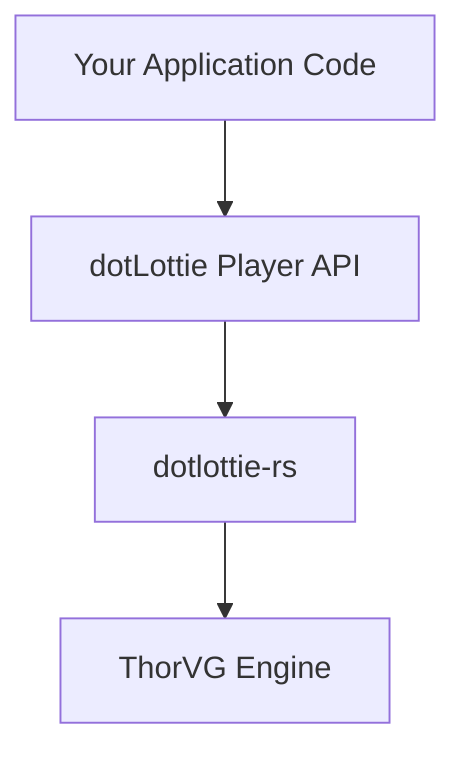
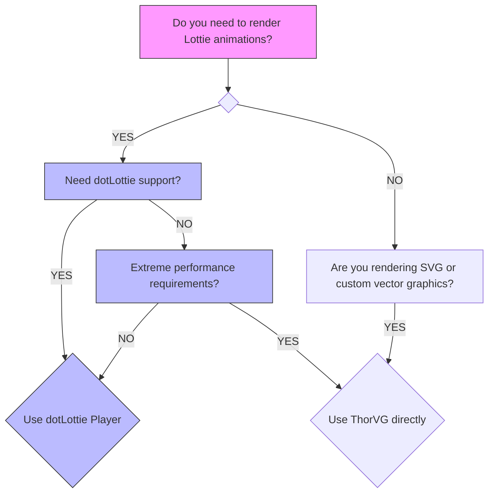

# ThorVG
Learn about ThorVG, the open-source rendering engine that powers dotLottie players. Discover its performance benefits, cross-platform consistency, and when to use it directly.

## What is ThorVG?

**ThorVG** (Thor Vector Graphics) is an open-source C/C++ library designed for drawing vector-based graphics primitives and scenes. It serves as a lightweight, universal rendering solution that works consistently across multiple platforms and rendering backends.

<Grid columns={2}>
  <Feature title="Identical Output Everywhere">
    Same rendering engine powers JavaScript, React, iOS, Android, and React Native players. Your animations look
    identical across all platforms—guaranteed.
  </Feature>

  <Feature title="Hardware-Accelerated Performance">
    GPU-optimized rendering delivers smooth 60fps animations with minimal CPU overhead. Optimized for both battery life
    and performance.
  </Feature>

  <Feature title="Open Source & Community-Driven">
    MIT licensed with active development and community contributions. No vendor lock-in, full transparency, extensible
    by design.
  </Feature>

  <Feature title="Production-Proven at Scale">
    Trusted by enterprises rendering billions of animations monthly. Battle-tested reliability for mission-critical
    applications.
  </Feature>
</Grid>

### Key Characteristics

✓ **Open Source**: MIT-licensed and community-driven<br />
✓ **Cross-Platform**: Runs on Web (WASM), iOS, Android, Linux, Windows, and macOS<br />
✓ **Multi-Backend**: Supports CPU/SIMD, OpenGL, WebGL, and WebGPU rendering<br />
✓ **Lightweight**: Minimal dependencies and small footprint<br />
✓ **High Performance**: Optimized for speed and memory efficiency<br />
✓ **Consistent**: Pixel-perfect rendering across all platforms<br />

## Architecture & Rendering Backends

ThorVG's modular architecture allows it to adapt to different platforms and use cases.

### Supported Rendering Backends

<Grid columns="1">
  <Feature title="CPU/SIMD Backend (Software Rendering)" icon="PiCpu">
    - Use Case: Maximum compatibility, headless rendering, server-side - Performance: Excellent with SIMD optimization
      (SSE, AVX, NEON) - Platforms: All platforms - Best For: Node.js, servers, legacy hardware
  </Feature>

  <Feature title="OpenGL Backend" icon="SiOpengl">
    - Use Case: Native desktop and mobile applications - Performance: Hardware-accelerated, excellent for interactive
      content - Platforms: iOS, Android, Linux, Windows, macOS - Best For: Mobile apps, desktop applications
  </Feature>

  <Feature title="WebGL Backend" icon="SiWebgl">
    - Use Case: Web browsers - Performance: Hardware-accelerated in browsers - Platforms: All modern browsers - Best
      For: Web applications, responsive designs
  </Feature>

  <Feature title="WebGPU Backend" icon="SiWebgpu">
    - Use Case: Modern web applications (emerging standard) - Performance: Next-generation GPU performance - Platforms:
      Chromium-based browsers (expanding support) - Best For: High-performance web applications, future-proofing
  </Feature>
</Grid>

### Backend Selection

ThorVG automatically selects the optimal rendering backend based on:

- Platform capabilities
- Available hardware acceleration
- Performance requirements
- API availability

## Platform Support

ThorVG provides comprehensive platform coverage:

### Web Platforms

- **Browsers**: Chrome, Firefox, Safari, Edge
- **Technologies**: WASM, WebGL, WebGPU
- **Environments**: Browser, Web Workers, Service Workers

### Mobile Platforms

- **iOS**: 15.4+ and macOS 12.0+
- **Android**: API level 24+ (Android 7.0+)
- **React Native**: Cross-platform support

### Desktop Platforms

- **Linux**: Various distributions
- **Windows**: Windows 10+
- **macOS**: 12.0+

### Embedded & IoT

- **Tizen**: Samsung smart devices
- **WebOS**: LG smart TVs
- **Custom**: Adaptable to embedded systems

## Performance & Benchmarks

ThorVG delivers exceptional performance that translates directly into better user experiences.

### Real-World Performance

**Canva's Implementation**: When Canva integrated ThorVG into their platform, they achieved:

- **80% faster rendering** compared to their previous solution
- **70% reduction in memory usage** across animation workloads
- **Smoother playback** at higher frame rates

### Performance Characteristics

- **Efficient Memory Management**: Minimizes allocations and reuses buffers
- **SIMD Optimization**: Leverages CPU vector instructions for parallel processing
- **GPU Acceleration**: Hardware-accelerated rendering on supported backends
- **Lazy Loading**: Only processes visible elements
- **Multi-Threading**: Parallel rendering capabilities where available

### Benchmark Highlights

ThorVG consistently outperforms other vector rendering solutions in:

- **Animation frame rendering**: 2-3x faster than generic SVG renderers
- **Memory footprint**: 50-70% smaller than alternative solutions
- **Startup time**: Near-instantaneous initialization
- **Battery efficiency**: Reduced CPU usage means longer battery life on mobile

## Relationship to dotLottie Players

Understanding how ThorVG relates to dotLottie players helps you choose the right tool for your needs.

### How They Work Together



### Player Abstraction Benefits

dotLottie players provide:

- **Simplified API**: Easy-to-use methods for animation control
- **Framework Integration**: React, Vue, Svelte components
- **Feature Management**: Theming, state machines, multi-animation
- **Event System**: Lifecycle hooks and callbacks
- **Platform Conventions**: Native idioms for each platform

### Direct ThorVG Usage

Using ThorVG directly provides:

- **Maximum Performance**: Eliminate abstraction overhead
- **Custom Rendering**: Full control over the render pipeline
- **Advanced Features**: Access to low-level graphics capabilities
- **Custom Formats**: Render SVG and other vector formats beyond Lottie

## When to Use ThorVG Directly

### Use dotLottie Players When:

- You need to display Lottie or dotLottie animations
- You want simple integration with minimal setup
- You need framework-specific components (React, Vue, Svelte)
- You want to use theming and state machines
- You prefer high-level APIs over low-level control
- You're building typical web or mobile applications

**Recommendation**: Most developers should use dotLottie players. They provide the best balance of ease-of-use, features, and performance for animation playback.

### Use ThorVG Directly When:

- You need **ultra-high performance** and want to eliminate any abstraction overhead
- You're building a **custom animation engine** or renderer
- You need to render **SVG or other vector formats** beyond Lottie
- You require **custom rendering pipelines** with advanced control
- You're implementing **server-side rendering** of animations
- You're creating **developer tools** or animation editors
- You're working with **embedded systems** with constrained resources
- You need **headless rendering** for image/video generation

### Decision Framework



## Getting Started with ThorVG

### For Advanced Users

If you've determined that direct ThorVG usage is right for your project, here are the starting points:

#### Web (WASM)

```javascript
// ThorVG is typically accessed through dotLottie players
// For direct usage, see the ThorVG repository for WASM builds
import ThorVG from "thorvg-wasm";

// Initialize ThorVG
const canvas = document.getElementById("myCanvas");
const thorvg = await ThorVG.initialize(canvas);

// Load and render SVG or other vector content
thorvg.load(vectorData);
thorvg.render();
```

#### Native Platforms (C++)

```cpp
#include <thorvg.h>

// Initialize ThorVG
tvg::Initializer::init(tvg::CanvasEngine::Sw, 0);

// Create canvas
auto canvas = tvg::SwCanvas::gen();
canvas->target(buffer, width, width, height, tvg::SwCanvas::ARGB8888);

// Load and draw
auto picture = tvg::Picture::gen();
picture->load("animation.svg");
canvas->push(std::move(picture));
canvas->draw();
canvas->sync();

// Cleanup
tvg::Initializer::term(tvg::CanvasEngine::Sw);
```

#### Mobile Integration

For iOS and Android, ThorVG is typically integrated through dotLottie player SDKs. Direct usage requires building ThorVG from source and linking it with your application.

### Build from Source

ThorVG uses Meson build system:

```bash
# Clone repository
git clone https://github.com/thorvg/thorvg.git
cd thorvg

# Configure build
meson setup builddir

# Build
meson compile -C builddir

# Run tests
meson test -C builddir
```

### Integration Considerations

When using ThorVG directly:

1. **Threading**: Manage your own threading model
2. **Resource Management**: Handle loading and cleanup
3. **Event Loop**: Integrate with your application's event system
4. **Platform Differences**: Handle platform-specific code paths
5. **Updates**: Monitor ThorVG releases for improvements

## Features & Capabilities

### Vector Graphics Support

- **Shapes**: Paths, rectangles, circles, ellipses, polygons
- **Strokes**: Various stroke styles, line caps, line joins
- **Fills**: Solid colors, gradients (linear, radial)
- **Transformations**: Translate, rotate, scale, skew, matrix
- **Clipping**: Path-based clipping and masking
- **Compositing**: Blend modes and opacity

### Lottie-Specific Features

- **Full Lottie Spec**: Comprehensive support for Lottie features
- **Expressions**: JavaScript expression evaluation
- **Effects**: Supported effects and filters
- **Assets**: Images, precomps, fonts
- **Markers**: Timeline markers and segments

### Performance Features

- **Viewport Culling**: Skip rendering of off-screen elements
- **Dirty Rectangles**: Only redraw changed regions
- **Path Caching**: Cache complex path computations
- **Texture Atlas**: Optimize texture memory usage
- **Batch Rendering**: Minimize draw calls

## Why ThorVG Matters

### LottieFiles Sponsorship

LottieFiles is a proud sponsor of the ThorVG project, investing in its development to ensure the best possible rendering experience for Lottie and dotLottie animations. This partnership enables:

- **Continuous Improvement**: Regular updates and performance optimizations
- **Lottie-Specific Features**: First-class support for Lottie/dotLottie specifications
- **Community Growth**: Active development and community contributions
- **Long-Term Stability**: Sustained maintenance and support

### The Foundation of dotLottie Players

All official dotLottie players—across Web, iOS, and Android—use ThorVG as their rendering engine. This architectural decision provides several critical advantages:

- **Guaranteed Consistency**: Animations look identical across all platforms
- **Unified Codebase**: Single rendering engine reduces maintenance overhead
- **Performance Optimized**: Heavily optimized for animation workloads
- **Future-Proof**: Support for modern rendering APIs and techniques

## Resources

### Official Resources

- **[ThorVG GitHub Repository↗](https://github.com/thorvg/thorvg)**: Source code, issues, and contributions
- **[ThorVG Website↗](https://www.thorvg.org/)**: Project homepage and overview
- **[ThorVG Documentation↗](https://www.thorvg.org/docs)**: API documentation and guides
- **[Release Notes↗](https://github.com/thorvg/thorvg/releases)**: Latest updates and changes

### Community & Support

- **[GitHub Discussions↗](https://github.com/thorvg/thorvg/discussions)**: Community Q\&A
- **[GitHub Issues↗](https://github.com/thorvg/thorvg/issues)**: Bug reports and feature requests
- **[Contributing Guide↗](https://github.com/thorvg/thorvg/blob/main/CONTRIBUTING.md)**: How to contribute

### Benchmarks & Performance

- **[Performance Reports↗](https://github.com/thorvg/thorvg/wiki/Performance)**: Detailed benchmark results
- **[Canva Case Study↗](https://www.canva.dev/)**: Real-world implementation results
